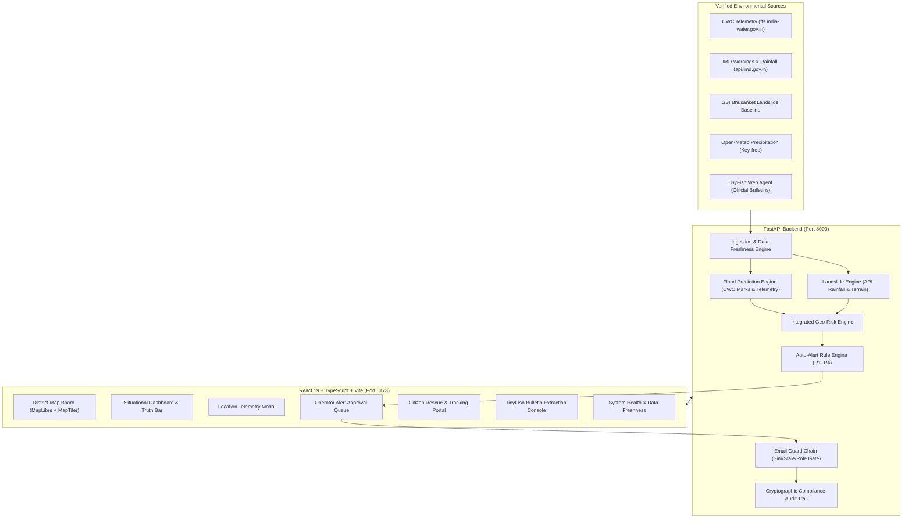

# NE-SAFE AI — Northeast India Disaster Risk Monitoring & Early-Warning Platform

[](https://pytest.org)
[](https://www.typescriptlang.org)
[](https://fastapi.tiangolo.com)
[](https://react.dev)
[](https://cloud.maptiler.com)
[](https://tinyfish.ai)
[](LICENSE)

An explainable, human-in-the-loop early-warning platform monitoring developing **flood and rainfall-triggered landslide risks** across the 8 states of Northeast India: **Assam, Meghalaya, Arunachal Pradesh, Sikkim, Nagaland, Manipur, Mizoram, and Tripura** (19 monitored locations, 7 CWC river telemetry stations, 78 districts).

---

## 1. System Architecture



---

## 2. Product Principles & Safety-First Governance

1. **Safety before automation**: AI-generated alerts are created in `PROPOSED` status and require human operator review before approval and dissemination.
2. **Evidence before prediction**: Every score cites telemetry readings, official CWC danger/warning marks, or documented GSI baseline susceptibility. AI never overrides official government thresholds.
3. **No fabricated data**: Missing, delayed, or unconfigured feeds are displayed honestly as `UNAVAILABLE`, `STALE`, or `MISSING`.
4. **Official warnings remain authoritative**: Official IMD and CWC bulletins are passed through verbatim with distinct `OFFICIAL_AGENCY` badges.
5. **Rescue honesty**: Citizen rescue forms explicitly display: *"This form does not dispatch help automatically. In an emergency call 112."*
6. **Public notification guardrail**: `PUBLIC_ALERTS_ENABLED=false` by default until models and telemetry are officially validated by local disaster authorities.

---

## 3. Data Source Status Matrix

| Data Source | Status | Protocol | Provenance & Policy |
|---|---|---|---|
| **CWC Brahmaputra & Barak Basins** | **LIVE** | REST / HTML Telemetry | Real river water levels from 7 gauge stations (Pandu, Dibrugarh, Silchar, etc.) |
| **Open-Meteo Precipitation** | **LIVE** | Key-free REST API | 24h observed rainfall and forecast precipitation with caching |
| **MapTiler Vector Basemap** | **LIVE** | Vector Tiles (`VITE_MAPTILER_API_KEY`) | Streets, Outdoor, Topographic, and Satellite styles covering Northeast India |
| **TinyFish Web Extraction** | **LIVE** | Agentic API (`TINYFISH_API_KEY`) | Extracts official government disaster bulletins from IMD, CWC, and GSI allowlisted domains |
| **IMD District Warnings** | **KEY-GATED** | REST (`IMD_API_KEY`) | Official warnings ingested verbatim; falls back to baseline when key is unconfigured |
| **GSI Bhusanket Landslide Susceptibility** | **BASELINE** | Reference Constants | GSI portal lacks a public REST API; uses documented susceptibility constants with provenance |

---

## 4. Quickstart Guide

### Prerequisites
- **Python 3.11+**
- **Node.js 18+** and **npm**
- **Git**

### A. Clone and Setup
```bash
git clone https://github.com/YOUR_USERNAME/ne-safe-ai.git
cd ne-safe-ai
```

### B. Backend Setup
```bash
# 1. Create and activate virtual environment
python -m venv venv
.\venv\Scripts\activate       # Windows PowerShell
# source venv/bin/activate    # Linux / macOS

# 2. Install dependencies
pip install -r backend/requirements.txt

# 3. Configure environment
copy .env.example .env        # Windows
# cp .env.example .env        # Linux / macOS

# 4. Start FastAPI backend server
uvicorn app.main:app --app-dir backend --host 127.0.0.1 --port 8000 --reload
```
The backend API is accessible at `http://127.0.0.1:8000` with interactive docs at `http://127.0.0.1:8000/docs`.

### C. Frontend Setup
```bash
# In a new terminal:
cd frontend
npm install

# Configure frontend environment
copy .env.example .env        # Windows
# cp .env.example .env        # Linux / macOS

# Start Vite dev server
npm run dev
```
The application dashboard is available at `http://localhost:5173`.

---

## 5. Docker Deployment

Deploy the entire stack with Docker Compose:
```bash
docker-compose up --build
```
- Frontend: `http://localhost:5173`
- Backend API: `http://localhost:8000`

---

## 6. Environment Configuration

### Backend (`.env` or `backend/.env`)
| Variable | Default | Purpose |
|---|---|---|
| `APP_ENV` | `development` | Runtime environment (`development` / `production`) |
| `DATABASE_URL` | `sqlite:///./ne_safe.db` | SQLAlchemy database URL |
| `FRONTEND_ORIGIN` | `http://localhost:5173` | CORS allowed origin |
| `TINYFISH_API_KEY` | *(optional)* | TinyFish Web Agent API key for bulletin extraction |
| `TINYFISH_API_URL` | `https://api.fetch.tinyfish.ai` | TinyFish endpoint |
| `IMD_API_KEY` | *(optional)* | Official IMD REST API key |
| `PUBLIC_ALERTS_ENABLED` | `false` | Master toggle for email dispatch (safety gate) |
| `AUTO_SYNC_ENABLED` | `true` | Scheduled 30-minute background telemetry sync |

### Frontend (`frontend/.env`)
| Variable | Default | Purpose |
|---|---|---|
| `VITE_API_BASE_URL` | `http://127.0.0.1:8000/api/v1` | Backend API URL |
| `VITE_MAPTILER_API_KEY` | *(optional)* | MapTiler key for high-resolution vector basemaps |

---

## 7. Testing & Quality Verification

### Run Backend Test Suite (85 Tests)
```bash
pytest backend/tests/ -v
```
Verifies acceptance criteria, email safety guard chains, auto-alert escalation rules, historical case validation (12 disaster events), IMD REST adapters, Open-Meteo service, TinyFish web extraction, and security/rate-limiting.

### Run Frontend Typecheck & Build
```bash
cd frontend
npx tsc -p tsconfig.app.json --noEmit   # Strict TypeScript check (0 errors)
npm run build                          # Production Vite bundle (0 errors)
npm run lint                           # Oxlint code quality scan (0 errors)
```

---

## 8. API Reference Overview

| Method | Endpoint | Description |
|---|---|---|
| `GET` | `/api/v1/health` | Service health, database status, and monitored location counts |
| `GET` | `/api/v1/map/districts` | District-level flood/landslide risk, rainfall, and official warnings |
| `GET` | `/api/v1/risk/geo` | Monitored location GeoJSON with dual-hazard probabilities |
| `GET` | `/api/v1/alerts` | Active and proposed disaster alert queue |
| `POST` | `/api/v1/alerts/{alert_id}/approve` | Operator approval of proposed alerts (`x-user-role: OPERATOR`) |
| `POST` | `/api/v1/rescue-requests` | Citizen assistance submission (returns `RR-XXXXXX`) |
| `POST` | `/api/v1/rescue-requests/{id}/status` | Responder status transition (`SUBMITTED` $\rightarrow$ `RECEIVED` $\rightarrow$ `ASSIGNED` $\rightarrow$ `EN_ROUTE` $\rightarrow$ `SERVED`) |
| `GET` | `/api/v1/reports/situation?format=pdf` | Cryptographically stamped situation report export (PDF / CSV) |
| `GET` | `/api/v1/analytics/overview` | Telemetry analytics datasets for charts |
| `GET` | `/api/v1/sources/tinyfish/status` | TinyFish integration health and rate limit status |
| `POST` | `/api/v1/sources/tinyfish/retrieve` | Authorized government bulletin extraction |

---

## 9. GitHub Repository Upload Instructions

```bash
git init
git add .
git status                   # Confirm .env, *.db, and credentials are NOT staged
git commit -m "Complete NE-SAFE AI early warning system with MapTiler and TinyFish integrations"
git branch -M main
git remote add origin https://github.com/YOUR_USERNAME/ne-safe-ai.git
git push -u origin main
```

---

## 10. License

This project is licensed under the MIT License — see the [LICENSE](LICENSE) file for details.
